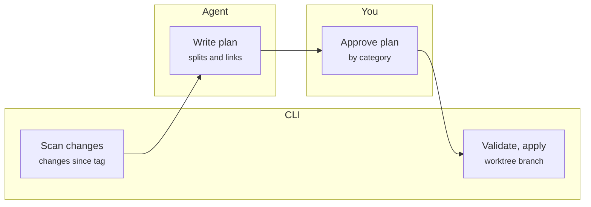

# vault-curator: Design Spec

Oct 17, 2026 · Devin Nemec

## Summary

vault-curator is a set of portable agent skills plus a Go CLI that turns a flat, unlinked markdown vault into a linked, typed knowledge base, with every change reviewed before it is committed.

**Problem.** Capture is fine. Notes are taken fast as indented bullets, mostly in one daily note, and afterwards they stay flat: no links to projects, people or components, inconsistent formatting, several meetings piled into one file. Obsidian search returns every note that merely mentions a term, so related meetings can't be found.

**What it does.**

- Finds notes changed since the last curation, restructures them, splits mixed-topic notes, and links them to project, component and person notes.
- Extracts decisions, constraints, open questions and action items, and flags decisions that deserve an ADR.
- Maintains hub notes per project and component, with ordered meeting timelines, open actions and Mermaid views.
- Produces a context pack before a design or grilling session, so decisions already made are not re-litigated from memory.
- Exposes the component graph as JSON for other agents, such as a local troubleshooting agent.

**v1 success, judged after two weeks of use.**

- No orphan notes: every note links to at least one hub, with a named fallback hub for the rest.
- A meeting about a component shows up on that component's hub, in sequence with the other meetings on the same project.
- Open actions and prior decisions for a project can be listed without searching.
- You find notes by following links, not by guessing from titles.

## Users and environments

v1 is a single-user tool: each person curates their own vault. Teams may adopt it, but nobody co-edits a shared vault.

| Environment | Agent | Notes |
| --- | --- | --- |
| Personal machine | Claude | Personal vault, personal public git repo. The first target. |
| Work machine | Code Puppy | Has Jira, Confluence and GitHub connections plus local clones of team repos. Skills and MCP are close to Claude's but not identical. Work vault never syncs to the personal side. |
| Family use | Codex | Same skill repo, thin per-tool adapter. |

**Constraints.**

- Plain markdown in git. No database, no required plugin. The vault stays portable and readable in any tool.
- Vault is synced by a nightly cron push, which curation must not interfere with.
- Folder layout is ignored. Links and frontmatter carry structure, so existing folders need no migration.
- The user's machine-level `AGENTS.md` (home directory) holds the vault path. Repo-level `AGENTS.md` files never do, because paths differ per person. Personal projects may be an exception.
- Build Claude-first, publish the skill repo, then adapt it for Code Puppy and Codex from the published repo.

## Architecture

Judgment lives in the agent and determinism lives in a Go CLI, joined by a plan file the user reviews. The agent never edits the vault directly.

*The agent proposes, you approve, the CLI applies. Merging the branch moves the watermark tag.*

The plan is the only thing that crosses from agent to CLI, and the user's approval is the only gate between them.

1. **Scan.** `vault-curator scan` emits JSON: files changed since the watermark tag, their blocks, the link graph, the entity index and orphans.
2. **Plan.** The agent reads the scan and writes a plan (JSON): splits, restructures, links, new entity stubs, decisions, edges and ADR flags.
3. **Review.** `vault-curator review` renders the plan as a markdown document. The user approves by editing statuses, by category with exceptions.
4. **Apply.** `vault-curator apply` validates the plan (lossless check, no broken links, nothing unapproved), applies it in a separate git worktree on a branch, and commits. Merging the branch moves the watermark tag.

**Skills** (standard `SKILL.md` folders, thin adapters per tool):

| Skill | Job |
| --- | --- |
| curate | Inbox sweep and on-demand curation of one note or folder |
| backfill | One-time pass over the existing vault, in small reviewable batches, entity seeding first |
| entities | Create, merge and alias people, projects, components and systems |
| context | Build the pre-session context pack for a project or feature |
| ask | Answer questions from the vault using graph queries and ripgrep, citing notes |

**Go CLI.** Parsing markdown and frontmatter, block hashing, link graph, git watermark, plan validation and apply, hub-block regeneration, Mermaid generation, and graph queries (`timeline`, `backlinks`, `decisions`, `graph --json`). Shipped as Mac and Windows binaries through GitHub releases. A missing binary fails with install instructions, with no agent-only fallback.

**No MCP server in v1.** Access is local, so skills call the CLI directly. Every query command has a `--json` flag so other agents can use the vault without extra infrastructure.

## Note model

Structure comes from note types, frontmatter and links, never from folders. Frontmatter is a small block of metadata between two `---` lines at the top of a note. The curation pass writes it, so the user never types it.

| Note type | Purpose |
| --- | --- |
| daily | The day's capture. After curation it is a timeline of links to the notes split out of it. |
| meeting | One meeting or session: restructured points, plus marked Decisions, Constraints, Open questions and Action items sections. |
| project / component | A hub. Holds aliases, `repos:`, typed edges, and generated blocks (meeting timeline, open actions, Mermaid views). |
| person | Relationship context for people who recur in notes. Created only with approval. |

| Frontmatter field | Meaning |
| --- | --- |
| `type` | One of the note types above |
| `date` | Meeting or capture date |
| `project` / `topics` | Primary subjects, inferred by the agent and confirmed in review. Everything else mentioned stays an inline link. |
| `aliases` | Alternate names on entity notes (for example SMP, the SMP project). Also drives Obsidian autocomplete. |
| `repos` | On project hubs: repo names or remote URLs, used to map a repo to its project |
| `links` | External references such as ticket IDs and Confluence URLs, recorded as plain links |
| `supersedes` | Optional pointer from a decision to the one it replaces |

**Links.** Wikilinks (`[[note]]`) in the vault, since that is how the user types in Obsidian. A CLI flag exports a standard-markdown copy for GitHub rendering.

**Primary versus mention.** A meeting is *about* one or two projects or components. Those drive hub timelines. All other entities mentioned are links only, which fixes search results full of incidental mentions.

**Entities.** Seeded from the existing vault (titles, frequent terms) on first run and proposed in one batch for approval. New names met later are proposed, never silently created.

**Orphans.** The goal is zero. A note that fits no hub is flagged in review with a best-guess hub. If the answer is none, it goes to a named fallback hub (Unsorted), so every note ends up somewhere chosen.

## Curation pipeline

**Detecting raw notes.** No manual label, because the user will forget one. The watermark is a git tag on the last curation commit. Files changed since the tag are candidates. Inside a changed file, the unit is the top-level bullet block, and the CLI remembers which blocks were already processed, so a daily note appended to all day is handled correctly. The nightly cron commit does not move the tag.

**Restructure, don't duplicate.** A curated note replaces its raw form instead of sitting beside it. Indentation is repaired, points are grouped under topic headings, and formatting is normalized. The user's wording and content are kept. Lines moved into Decisions or Action items move out of the body. Raw text is always recoverable from the watermark tag in git.

**Lossless check.** Every original bullet must map to a destination in the plan. Anything unmapped blocks apply. Review shows the mapping.

**Splitting.** Today the daily note holds several meetings, separated by blank lines and by inconsistent top-level indentation, sometimes with level 2 or 3 bullets that are really separate meetings. The agent proposes boundaries, the review shows them, and the user approves. Each split block moves to a new note titled with the date and topic, and a wikilink line stays in the daily note so it reads as the day's timeline. The user is also moving to one note per meeting, so splitting is a safety net for legacy and slips, not the main path. An optional Obsidian template (date, attendees, frontmatter) helps capture but is never required.

**Autonomy tiers.**

| Tier | Changes | Behavior |
| --- | --- | --- |
| Auto | Formatting, indentation, frontmatter, appended link suggestions, generated hub blocks | Applied once the plan is approved by category |
| Approve each | Splits, renames, moves, merges, new entities, typed edges, supersedes links, aliases, retargeted links, ADR drafts | Listed individually in review |
| Never | Inventing content, silently dropping lines, closing action items | Not permitted |

**Backfill.** On install, the backfill skill curates the existing vault (a few dozen notes today) in small reviewable batches. The first batch seeds entities (people, projects, components), because everything else links to them.

## Decisions, actions and ADRs

A past team lost track of informal decisions made in meetings, so what was decided, and what later changed it, was unrecoverable. This section is the main guard against that, and open actions are the daily driver.

**Extracted sections.** Each meeting note gets marked sections, regenerated on every curation: Decisions, Constraints and requirements, Open questions, Action items. Items are moved out of the body, not copied, and each links to its source block.

**Action items.**

- Standard markdown checkboxes (`- [ ]`) with owner and source meeting as inline fields.
- The user ticks items off. The agent may suggest in review that one looks done, but never closes it.
- Each project hub shows its open actions. One vault-wide view is filterable by owner.

**Decisions.**

- Kept as a dated list per project, each linking to its meeting.
- When a new decision touches the same topic as an earlier one, review shows both side by side and asks whether it supersedes. If confirmed, a `supersedes` link is written. History is never guessed silently.

**ADR flagging.** A decision is ADR-worthy when it affects architecture, crosses teams, or is hard to reverse. The skill flags it and drafts the ADR, but never publishes. ADRs live in the project's own repo, so drafts land in a staging folder in the vault for the user to review and copy over. A decision that spans repos names a proposed home repo (the one owning the most-affected component) plus the other affected components and repos. The user chooses. The ADR format is a pluggable template file in the vault config.

## Component graph and diagrams

The full component graph is for agents. A single graph of every subsystem is too dense for people, so humans get small scoped views.

**Typed edges.** Relationships are stored in the component note, from a small fixed vocabulary: `depends-on`, `owned-by`, `calls`, `part-of`, `related-to`. The agent proposes each edge with a citation to the source meeting, and the user approves it in review.

**Agent access.** `vault-curator graph --component <name> --depth <n> --json` returns the neighborhood of a component, so a local troubleshooting agent can understand how systems relate.

**Human views: Mermaid only.** Diagrams must render in Obsidian and in GitHub markdown, and stay machine-readable.

| Diagram | Where | How |
| --- | --- | --- |
| Component flowchart, depth 1 to 2 | Each component or project hub | Generated block between marker comments. Large clusters split into several scoped diagrams. |
| Meeting and decision timeline | Each project hub | Generated block |
| Sequence diagram | Proposed in review only | Interpretation, not fact, so never auto-generated |
| Diagrams the user drew | Anywhere | Preserved byte for byte, never regenerated |

External sources (repos, Confluence, Jira) are a later way to seed edges. The edge format does not change when they arrive.

## Retrieval and the context pack

Retrieval in v1 is structure, not search infrastructure. Graph queries run on demand from the markdown files, combined with ripgrep for free text. There is no cache, index or embeddings. Embeddings return only if links and text search leave real gaps, such as not remembering what something was called.

**Questions the vault must answer, in priority order.**

1. What actions are open, and what did we decide about how to settle them?
2. What relationships exist between components?
3. Show every meeting about a project or component, in order.

**Context pack.** Before a design or grilling session in a repo, the agent calls `vault-curator context <project>` at session start. The pack is generated fresh each time, with every item citing its source note:

- Decisions made, with dates and meetings
- Constraints and requirements
- Open questions nobody answered
- Open action items
- Related components, as a Mermaid diagram
- Links to source notes

**Answers.** The ask skill returns a written answer that cites notes by link, so the user can verify it. A saved synthesis note is created only on request, and carries agent provenance (source and date).

**Finding the vault and project.** The vault path lives in the user's machine-level `AGENTS.md`. Mapping a repo to a project lives in the vault: each project hub lists `repos:`, and the CLI resolves the current git remote to a project. With no match, the skill asks once and saves the answer in the hub.

## Git, packaging and testing

**Git workflow.** Curation runs in a separate git worktree on its own branch, so the user's Obsidian session and the nightly cron push are untouched until the user merges. The skill never leaves a half-applied state in the main tree. Each run commits before and after, and merging the branch moves the watermark tag.

**Repo layout** (public repo, working name `vault-curator`):

- `skills/`: `SKILL.md` folders for curate, backfill, entities, context and ask
- `cmd/`: Go source for the CLI
- `adapters/`: thin notes per tool for Claude, Code Puppy and Codex
- `testdata/`: a synthetic vault

**Distribution.** Go binaries for Mac and Windows are published as GitHub release assets, not committed to the repo, so history stays small and versions are explicit. The skill checks the binary's version on first use and fails with install instructions if it is missing.

**Testing.** A synthetic vault is the test fixture and the demo: fake meetings, fake components and deliberately messy daily notes, with mixed indentation, blank-line separators and several meetings in one file. Tests cover scan, plan validation (including the lossless check), apply on a worktree, hub regeneration, and graph queries, all without touching real notes.

**Portability.** One skill repo, loaded into Claude first. Code Puppy and Codex versions are adapted from the published repo, using Code Puppy itself for the conversion.

## Deferred and non-goals

- Shared or team-edited vaults. Teams may each run their own copy.
- Embeddings, vector store or cached index.
- An MCP server for local access.
- Retrieval across Jira, Confluence and GitHub, and seeding entities and edges from them. The vault format leaves room (`links:` field, typed edges), and this is expected to expand later through Code Puppy's connectors.
- An agent-only fallback when the CLI binary is missing.
- Auto-generated sequence diagrams, auto-closing action items, auto-published ADRs.

## Open items

- [ ] **ADR template.** The user will supply the team's ADR format during the Code Puppy conversion. The template file in vault config is a placeholder until then.
- [ ] **Code Puppy specifics.** Skill loading and MCP details were not verified. Confirm during the conversion.
- [ ] **Lossless check definition.** Decide how a lightly reworded or regrouped bullet maps to its original (per-bullet mapping with a normalized text match is the starting point).
- [ ] **Split accuracy.** Test boundary detection against real messy daily notes, not only the synthetic fixture, before trusting it beyond review.
- [ ] **Primary-topic inference.** Needs a small evaluation set in the fixture so quality can be measured, since it drives hub timelines.
- [ ] **Fallback hub name.** Unsorted is a placeholder.
- [ ] **Project name.** `vault-curator` is a working name.
- [ ] **Work data boundary.** Confirm that work notes are only ever curated on the work machine with Code Puppy, and that the Claude version runs on the personal vault only.

## Suggested build order

Each step is usable on its own and builds on the one before.

1. **Fixture and scan.** Synthetic messy vault; Go parsing of markdown, blocks, links and frontmatter; git watermark tag; `scan --json`.
2. **Plan, review, apply.** Plan schema, markdown review renderer, validation including the lossless check, apply in a worktree on a branch.
3. **Curate skill.** Restructure, frontmatter, links, splitting of the daily note, with review.
4. **Entities and backfill.** Entity seeding from the existing vault, then batched backfill.
5. **Hubs.** Generated meeting timelines, open-action blocks and scoped Mermaid views.
6. **Decisions and ADRs.** Extraction of decisions, constraints, questions and actions; supersedes detection; ADR flagging and drafts.
7. **Retrieval.** Graph queries, `context` pack, `ask` skill, `graph --json`.
8. **Release and adapters.** Binaries on GitHub releases, Code Puppy and Codex adapters.
