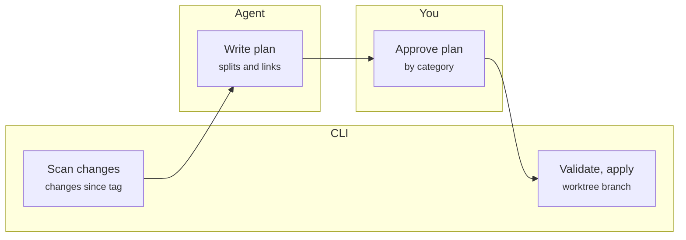
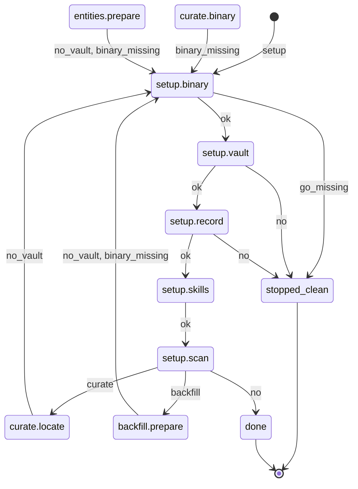
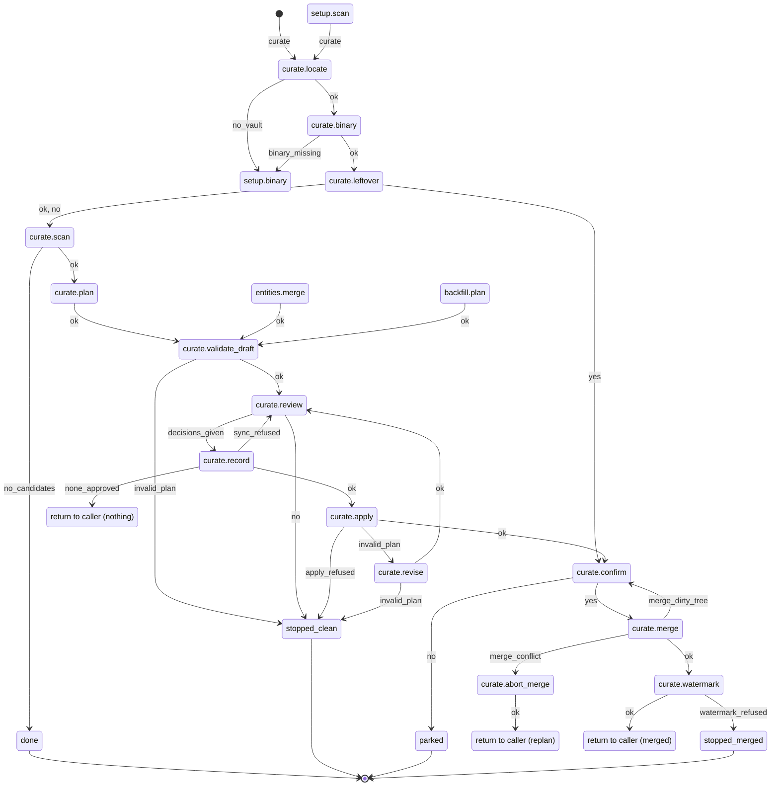
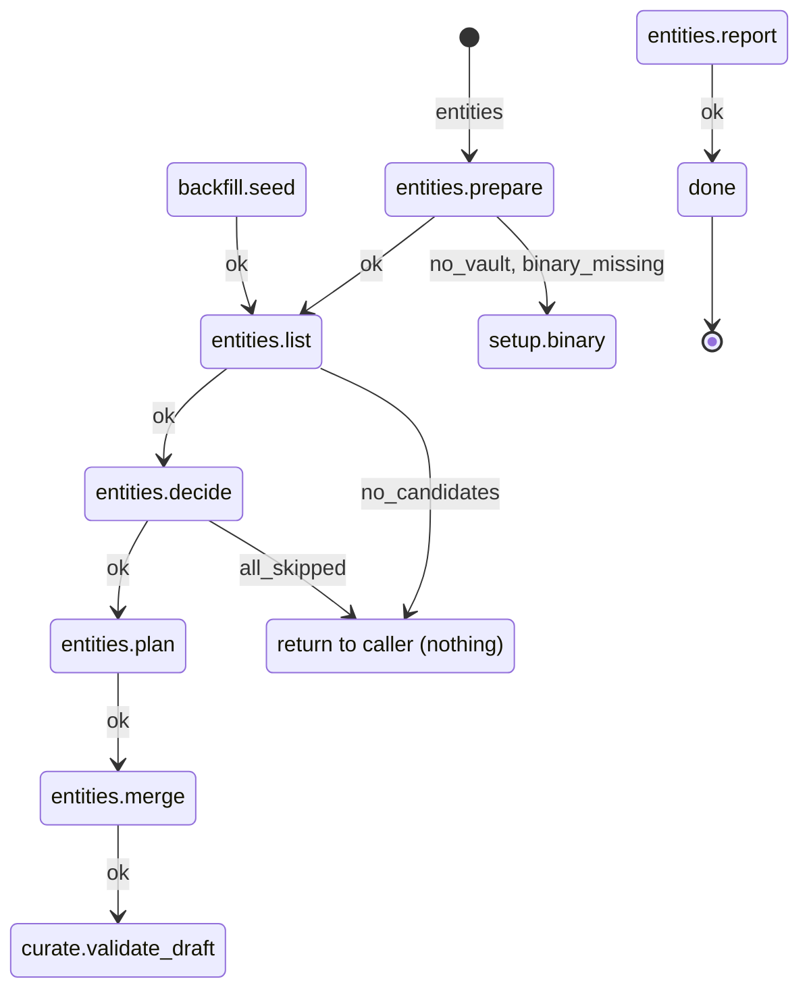
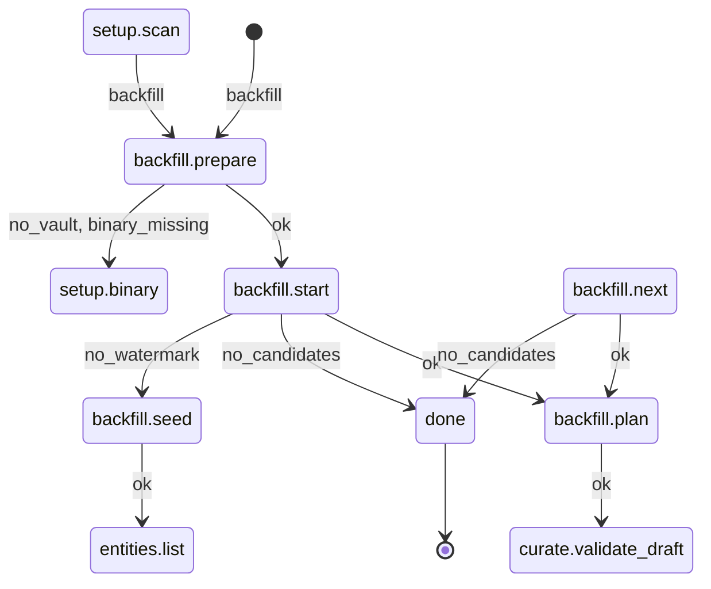

# vault-curator: Design Spec

Oct 17, 2026 · Devin Nemec

## Summary

vault-curator is a set of portable agent skills plus a Go CLI that turns a flat, unlinked markdown vault into a linked, typed knowledge base, with every change reviewed before it is committed.

**Problem.** Capture is fine. Notes are taken fast as indented bullets, mostly in one daily note, and afterwards they stay flat: no links to projects, people or components, inconsistent formatting, several meetings piled into one file. Obsidian search returns every note that merely mentions a term, so related meetings can't be found.

**What it does.**

- Finds notes changed since the last curation, restructures them, splits mixed-topic notes, and links them to project, component and person notes.
- Extracts decisions, constraints, open questions and action items, and flags decisions that deserve an ADR.
- Maintains hub notes per project and component, with ordered meeting timelines, open actions and Mermaid views.
- Produces a context pack before a design or grilling session, so decisions already made are not re-litigated from memory.
- Exposes the component graph as JSON for other agents, such as a local troubleshooting agent.

**v1 success, judged after two weeks of use.**

- No orphan notes: every note links to at least one hub, with a named fallback hub for the rest.
- A meeting about a component shows up on that component's hub, in sequence with the other meetings on the same project.
- Open actions and prior decisions for a project can be listed without searching.
- You find notes by following links, not by guessing from titles.

## Users and environments

v1 is a single-user tool: each person curates their own vault. Teams may adopt it, but nobody co-edits a shared vault.

| Environment | Agent | Notes |
| --- | --- | --- |
| Personal machine | Claude | Personal vault, personal public git repo. The first target. |
| Work machine | Code Puppy | Has Jira, Confluence and GitHub connections plus local clones of team repos. Skills and MCP are close to Claude's but not identical. Work vault never syncs to the personal side. |
| Family use | Codex | Same skill repo, thin per-tool adapter. |

**Constraints.**

- Plain markdown in git. No database, no required plugin. The vault stays portable and readable in any tool.
- Vault is synced by a nightly cron push, which curation must not interfere with.
- Folder layout is ignored. Links and frontmatter carry structure, so existing folders need no migration.
- The user's machine-level `AGENTS.md` (home directory) holds the vault path. Repo-level `AGENTS.md` files never do, because paths differ per person. Personal projects may be an exception.
- Build Claude-first, publish the skill repo, then adapt it for Code Puppy and Codex from the published repo.

## Architecture

Judgment lives in the agent and determinism lives in a Go CLI, joined by a plan file the user reviews. The agent never edits the vault directly.

*The agent proposes, you approve, the CLI applies. Merging the branch moves the watermark tag.*

The plan is the only thing that crosses from agent to CLI, and the user's approval is the only gate between them.

1. **Scan.** `vault-curator scan` emits JSON: files changed since the watermark tag, their blocks, the link graph, the entity index and orphans.
2. **Plan.** The agent reads the scan and writes a plan (JSON): splits, restructures, links, new entity stubs, decisions, edges and ADR flags.
3. **Review.** `vault-curator review` renders the plan as a markdown document. The user approves by editing statuses, by category with exceptions.
4. **Apply.** `vault-curator apply` validates the plan (lossless check, no broken links, nothing unapproved), applies it in a separate git worktree on a branch, and commits. Merging the branch moves the watermark tag.

**Skills** (standard `SKILL.md` folders, thin adapters per tool):

| Skill | Job |
| --- | --- |
| curate | Inbox sweep and on-demand curation of one note or folder |
| backfill | One-time pass over the existing vault, in small reviewable batches, entity seeding first |
| entities | Create, merge and alias people, projects, components and systems |
| context | Build the pre-session context pack for a project or feature |
| ask | Answer questions from the vault using graph queries and ripgrep, citing notes |

**Go CLI.** Parsing markdown and frontmatter, block hashing, link graph, git watermark, plan validation and apply, hub-block regeneration, Mermaid generation, and graph queries (`timeline`, `backlinks`, `decisions`, `graph --json`). Shipped as Mac and Windows binaries through GitHub releases. A missing binary fails with install instructions, with no agent-only fallback.

**No MCP server in v1.** Access is local, so skills call the CLI directly. Every query command has a `--json` flag so other agents can use the vault without extra infrastructure.

## Note model

Structure comes from note types, frontmatter and links, never from folders. Frontmatter is a small block of metadata between two `---` lines at the top of a note. The curation pass writes it, so the user never types it.

| Note type | Purpose |
| --- | --- |
| daily | The day's capture. After curation it is a timeline of links to the notes split out of it. |
| meeting | One meeting or session: restructured points, plus marked Decisions, Constraints, Open questions and Action items sections. |
| project / component | A hub. Holds aliases, `repos:`, typed edges, and generated blocks (meeting timeline, open actions, Mermaid views). |
| person | Relationship context for people who recur in notes. Created only with approval. |

| Frontmatter field | Meaning |
| --- | --- |
| `type` | One of the note types above |
| `date` | Meeting or capture date |
| `project` / `topics` | Primary subjects, inferred by the agent and confirmed in review. Everything else mentioned stays an inline link. |
| `aliases` | Alternate names on entity notes (for example SMP, the SMP project). Also drives Obsidian autocomplete. |
| `repos` | On project hubs: repo names or remote URLs, used to map a repo to its project |
| `links` | External references such as ticket IDs and Confluence URLs, recorded as plain links |
| `supersedes` | Optional pointer from a decision to the one it replaces |

**Links.** Wikilinks (`[[note]]`) in the vault, since that is how the user types in Obsidian. A CLI flag exports a standard-markdown copy for GitHub rendering.

**Primary versus mention.** A meeting is *about* one or two projects or components. Those drive hub timelines. All other entities mentioned are links only, which fixes search results full of incidental mentions.

**Entities.** Seeded from the existing vault (titles, frequent terms) on first run and proposed in one batch for approval. New names met later are proposed, never silently created.

**Orphans.** The goal is zero. A note that fits no hub is flagged in review with a best-guess hub. If the answer is none, it goes to a named fallback hub (Unsorted), so every note ends up somewhere chosen.

## Curation pipeline

**Detecting raw notes.** No manual label, because the user will forget one. The watermark is a git tag on the last curation commit. Files changed since the tag are candidates. Inside a changed file, the unit is the top-level bullet block, and the CLI remembers which blocks were already processed, so a daily note appended to all day is handled correctly. The nightly cron commit does not move the tag.

**Restructure, don't duplicate.** A curated note replaces its raw form instead of sitting beside it. Indentation is repaired, points are grouped under topic headings, and formatting is normalized. The user's wording and content are kept. Lines moved into Decisions or Action items move out of the body. Raw text is always recoverable from the watermark tag in git.

**Lossless check.** Every original bullet must map to a destination in the plan. Anything unmapped blocks apply. Review shows the mapping.

**Splitting.** Today the daily note holds several meetings, separated by blank lines and by inconsistent top-level indentation, sometimes with level 2 or 3 bullets that are really separate meetings. The agent proposes boundaries, the review shows them, and the user approves. Each split block moves to a new note titled with the date and topic, and a wikilink line stays in the daily note so it reads as the day's timeline. The user is also moving to one note per meeting, so splitting is a safety net for legacy and slips, not the main path. An optional Obsidian template (date, attendees, frontmatter) helps capture but is never required.

**Autonomy tiers.**

| Tier | Changes | Behavior |
| --- | --- | --- |
| Auto | Formatting, indentation, frontmatter, appended link suggestions, generated hub blocks | Applied once the plan is approved by category |
| Approve each | Splits, renames, moves, merges, new entities, typed edges, supersedes links, aliases, retargeted links, ADR drafts | Listed individually in review |
| Never | Inventing content, silently dropping lines, closing action items | Not permitted |

**Backfill.** On install, the backfill skill curates the existing vault (a few dozen notes today) in small reviewable batches. The first batch seeds entities (people, projects, components), because everything else links to them.

## Decisions, actions and ADRs

A past team lost track of informal decisions made in meetings, so what was decided, and what later changed it, was unrecoverable. This section is the main guard against that, and open actions are the daily driver.

**Extracted sections.** Each meeting note gets marked sections, regenerated on every curation: Decisions, Constraints and requirements, Open questions, Action items. Items are moved out of the body, not copied, and each links to its source block.

**Action items.**

- Standard markdown checkboxes (`- [ ]`) with owner and source meeting as inline fields.
- The user ticks items off. The agent may suggest in review that one looks done, but never closes it.
- Each project hub shows its open actions. One vault-wide view is filterable by owner.

**Decisions.**

- Kept as a dated list per project, each linking to its meeting.
- When a new decision touches the same topic as an earlier one, review shows both side by side and asks whether it supersedes. If confirmed, a `supersedes` link is written. History is never guessed silently.

**ADR flagging.** A decision is ADR-worthy when it affects architecture, crosses teams, or is hard to reverse. The skill flags it and drafts the ADR, but never publishes. ADRs live in the project's own repo, so drafts land in a staging folder in the vault for the user to review and copy over. A decision that spans repos names a proposed home repo (the one owning the most-affected component) plus the other affected components and repos. The user chooses. The ADR format is a pluggable template file in the vault config.

## Component graph and diagrams

The full component graph is for agents. A single graph of every subsystem is too dense for people, so humans get small scoped views.

**Typed edges.** Relationships are stored in the component note, from a small fixed vocabulary: `depends-on`, `owned-by`, `calls`, `part-of`, `related-to`. The agent proposes each edge with a citation to the source meeting, and the user approves it in review.

**Agent access.** `vault-curator graph --component <name> --depth <n> --json` returns the neighborhood of a component, so a local troubleshooting agent can understand how systems relate.

**Human views: Mermaid only.** Diagrams must render in Obsidian and in GitHub markdown, and stay machine-readable.

| Diagram | Where | How |
| --- | --- | --- |
| Component flowchart, depth 1 to 2 | Each component or project hub | Generated block between marker comments. Large clusters split into several scoped diagrams. |
| Meeting and decision timeline | Each project hub | Generated block |
| Sequence diagram | Proposed in review only | Interpretation, not fact, so never auto-generated |
| Diagrams the user drew | Anywhere | Preserved byte for byte, never regenerated |

External sources (repos, Confluence, Jira) are a later way to seed edges. The edge format does not change when they arrive.

## Retrieval and the context pack

Retrieval in v1 is structure, not search infrastructure. Graph queries run on demand from the markdown files, combined with ripgrep for free text. There is no cache, index or embeddings. Embeddings return only if links and text search leave real gaps, such as not remembering what something was called.

**Questions the vault must answer, in priority order.**

1. What actions are open, and what did we decide about how to settle them?
2. What relationships exist between components?
3. Show every meeting about a project or component, in order.

**Context pack.** Before a design or grilling session in a repo, the agent calls `vault-curator context <project>` at session start. The pack is generated fresh each time, with every item citing its source note:

- Decisions made, with dates and meetings
- Constraints and requirements
- Open questions nobody answered
- Open action items
- Related components, as a Mermaid diagram
- Links to source notes

**Answers.** The ask skill returns a written answer that cites notes by link, so the user can verify it. A saved synthesis note is created only on request, and carries agent provenance (source and date).

**Finding the vault and project.** The vault path lives in the user's machine-level `AGENTS.md`. Mapping a repo to a project lives in the vault: each project hub lists `repos:`, and the CLI resolves the current git remote to a project. With no match, the skill asks once and saves the answer in the hub.

## Git, packaging and testing

**Git workflow.** Curation runs in a separate git worktree on its own branch, so the user's Obsidian session and the nightly cron push are untouched until the user merges. The skill never leaves a half-applied state in the main tree. Each run commits before and after, and merging the branch moves the watermark tag.

**Repo layout** (public repo, working name `vault-curator`):

- `skills/`: `SKILL.md` folders for curate, backfill, entities, context and ask
- `cmd/`: Go source for the CLI
- `adapters/`: thin notes per tool for Claude, Code Puppy and Codex
- `testdata/`: a synthetic vault

**Distribution.** Go binaries for Mac and Windows are published as GitHub release assets, not committed to the repo, so history stays small and versions are explicit. The skill checks the binary's version on first use and fails with install instructions if it is missing.

**Testing.** A synthetic vault is the test fixture and the demo: fake meetings, fake components and deliberately messy daily notes, with mixed indentation, blank-line separators and several meetings in one file. Tests cover scan, plan validation (including the lossless check), apply on a worktree, hub regeneration, and graph queries, all without touching real notes.

**Portability.** One skill repo, loaded into Claude first. Code Puppy and Codex versions are adapted from the published repo, using Code Puppy itself for the conversion.

## Agent flow

Every path an agent can take through the setup, curate, entities and backfill skills is one deterministic finite automaton, defined as data in `internal/vaultcurator/flow` and checked by its tests in CI. The model exists so the flow has no dead ends, no traps and no unbounded loops, and so each skill step says exactly where to go on each outcome.

**States.** One state per skill step, plus the recovery states the review required (a declined merge, a dirty tree before merge, a merge conflict, validation failing after the decisions, an earlier run's leftover branch), the `start` state, and four terminals: `done`, `stopped_clean`, `parked` and `stopped_merged`. Each state has a one-line invariant, and the part the properties reason about (does a curation branch exist, is it merged, is a merge in progress) is recorded as data.

**Inputs.** An input is an outcome the agent can observe without judgement: a CLI exit code with the documented error kind (`invalid_plan`, `sync_refused`, `merge_conflict`, …), a git command's result, or a user answer (`yes`, `no`, `decisions_given`, the skill the user asks for). A step that retries its own command internally does so a bounded number of times its text states, and only the last outcome is the input (a draft that still fails validation after 3 fix rounds is `invalid_plan`).

**Hand-offs.** Skills hand off to each other through ordinary transitions: curate, entities and backfill hand off to setup when the CLI or the vault path is missing; setup hands off to curate or backfill when the user picks one; backfill hands off to entities to seed. The review-to-merge tail is written once, as curate steps 5 to 9, and curate, entities and backfill all hand off to it. It ends at a named exit (`merged`, `nothing`, `replan`), and the agent continues where the skill that started the run says (table under Exits). The DFA the properties check is the model expanded over that calling skill: its states are (state, caller) pairs, the caller set by entering a skill's first step. Calls are one level deep, so the expansion is finite and a plain DFA.

**Skill tags.** Every `##` step heading in a `skills/vault-curator/*/SKILL.md` ends with its state, as in `## 8. Apply (state: curate.apply)`. A `###` heading with a tag is a sub-step for a recovery state. A test fails when a step names no state, an unknown state or another skill's state, when a state has two steps, or when a step state has none. The start and terminal states have no step: a skill's `description` triggers it, and terminals do nothing.

**Properties.** Each has a test, and each test has a negative twin that breaks the model and expects the property to fail.

| Property | Guarantees | How it is checked |
| --- | --- | --- |
| Deterministic | The agent never chooses between two moves. | At most one transition per (state, input). |
| Complete | Every outcome the agent can observe has a move (finding 6: a failed merge, finding 7: validation failing after the decisions). | Every input a state lists has a transition, transitions use only listed inputs, and every exit reached in the expansion has a return for its caller. |
| Reachable | No step is dead text. | Breadth-first search of the expansion from `start` visits every state. |
| Co-reachable | No dead ends or traps: from anywhere, the run can end. | Terminals have no transitions; reverse search from the terminal nodes visits every reachable node. |
| Clean terminals | A run never ends half-applied. | Each transition carries its effect on the vault condition (branch created, merged, merge conflicted, merge aborted, watermarked), and every edge must turn the source's condition into the target's. No terminal has a merge in progress, and a terminal that leaves a curation branch (`parked`, `stopped_merged`) is allowed only because `curate.leftover` on `yes` takes it over in a later run. |
| Bounded loops | The agent never loops on its own: every repetition is the user's choice or makes measurable progress. | Delete every edge labelled with a user answer and every edge into a progress state (one that names a measure that strictly decreases on each visit); depth-first search must find no cycle in what remains. No state is a progress state today: every cycle passes through a user answer. |

"Bounded loops" lets a loop through the user's review answers repeat, because the user can stop it. Finding 8's loop, backfill seeding entities again whenever batch 1 merged nothing, passed through those answers, so a model-specific test also pins that `backfill.seed` lies on no cycle: seeding runs at most once per backfill.

The rest of this section is generated from the model; a test fails when it is stale.

<!-- vault-curator:begin agent-flow -->
<!-- Generated from internal/vaultcurator/flow. After changing the model, run: go test ./internal/vaultcurator/flow -run TestDesignDoc -update -->

### States

35 states: the start, 30 steps and 4 terminals. **Vault** is the machine-checked part of the invariant.

| State | Vault | Invariant |
| --- | --- | --- |
| `start` | no branch | Nothing has run; the vault is as the user left it. |
| `setup.binary` | no branch | No vault file has changed; the CLI may be missing or old. |
| `setup.vault` | no branch | The CLI is current; no vault file has changed. |
| `setup.record` | no branch | The vault folder is in a git work tree; no vault file has changed. |
| `setup.skills` | no branch | The vault path is recorded in ~/AGENTS.md and the product's global file. |
| `setup.scan` | no branch | The skills are installed; the vault is unchanged. |
| `curate.locate` | no branch | Nothing has run; the vault is as the user left it. |
| `curate.binary` | no branch | The vault folder is known and in a git work tree; nothing changed. |
| `curate.leftover` | no branch | The CLI runs; this run has no curation branch (earlier runs' curate/* branches may exist). |
| `curate.scan` | no branch | This run has no curation branch; the vault is unchanged. |
| `curate.plan` | no branch | The scan output is in hand; the vault is unchanged. |
| `curate.validate_draft` | no branch | A plan file exists with every status pending; no note has changed. |
| `curate.review` | no branch | The plan passes validate --draft and its review file is rendered; no note has changed. |
| `curate.record` | no branch | The user has decided every category and approve-each operation; the plan is not yet synced. |
| `curate.apply` | no branch | The plan holds the user's synced statuses, at least one approved; no note has changed. |
| `curate.revise` | no branch | The synced plan fails validation; nothing is applied. |
| `curate.confirm` | branch unmerged | A curate/* branch and its worktree hold the approved operations, unmerged; the user's branch has at most a snapshot of their own edits. |
| `curate.merge` | branch unmerged | The user confirmed this merge; the branch is unmerged. |
| `curate.abort_merge` | branch unmerged, merge in progress | A merge of the branch stopped on conflicts and is in progress on the user's branch. |
| `curate.watermark` | branch merged | The branch is merged into the user's branch; the watermark has not moved. |
| `entities.prepare` | no branch | Nothing has run; the vault is as the user left it. |
| `entities.list` | no branch | The vault is located and the CLI runs; this pass has no curation branch. |
| `entities.decide` | no branch | The entity and candidate lists are in hand; the vault is unchanged. |
| `entities.plan` | no branch | Every candidate has a verdict; the vault is unchanged. |
| `entities.merge` | no branch | The plan holds every seed and alias; merges are still to write. |
| `entities.report` | no branch | The entity plan is merged and watermarked; no curation branch is left. |
| `backfill.prepare` | no branch | Nothing has run; the vault is as the user left it. |
| `backfill.start` | no branch | The vault is located and the CLI runs; no batch has run in this backfill. |
| `backfill.seed` | no branch | No watermark exists and unprocessed notes remain; seeding has not run in this backfill. |
| `backfill.plan` | no branch | A batch from scan --all --limit is in hand; it has no curation branch. |
| `backfill.next` | no branch | The previous batch ended (merged and watermarked, applied nothing, or discarded); no curation branch is left. |
| **`done`** (terminal) | no branch | Finished: everything approved is merged and watermarked; no branch, worktree or merge in progress is left. |
| **`stopped_clean`** (terminal) | no branch | Stopped before the current pass applied anything; no branch, worktree or merge in progress is left. |
| **`parked`** (terminal) | branch unmerged | The user declined the merge: the branch and its worktree stay unmerged, the user's branch is untouched; curate.leftover finds it. |
| **`stopped_merged`** (terminal) | branch merged | The branch is merged but watermark refused; curate.leftover finds the branch, and finishing it runs watermark again. |

### Inputs

21 inputs.

| Input | Kind | Observed as |
| --- | --- | --- |
| `ok` | outcome | The step's commands exited 0 and its Done-when criterion holds. |
| `setup` | user answer | The user asks to install or set up vault-curator. |
| `curate` | user answer | The user asks to curate (or picks curate when setup offers it). |
| `entities` | user answer | The user asks to seed, add, alias or merge entities. |
| `backfill` | user answer | The user asks to backfill (or picks backfill when setup offers it). |
| `yes` | user answer | The user answers yes to the step's question. |
| `no` | user answer | The user answers no, declines, or asks to stop. |
| `decisions_given` | user answer | The user has answered every category and every approve-each operation. |
| `go_missing` | outcome | `go version` fails, so the CLI cannot be installed. |
| `no_vault` | outcome | The home-directory AGENTS.md names no existing vault folder in a git work tree. |
| `binary_missing` | outcome | `vault-curator version` is not found or exits non-zero. |
| `no_candidates` | outcome | The `scan` or `entities` JSON has an empty `candidates` list (entities: and the user asked for nothing specific). |
| `no_watermark` | outcome | The `scan --json` output has candidates and `watermark.exists` false. |
| `all_skipped` | outcome | Every entity candidate got the verdict skip. |
| `invalid_plan` | outcome | `validate` or `apply` exits 1 listing plan errors; in a fix step, still after its 3 fix rounds. |
| `sync_refused` | outcome | `review --sync` exits 1: an approve-each operation is still pending, or the plan changed since rendering. |
| `none_approved` | outcome | `review --sync` exits 0 and the plan has no approved operation. |
| `apply_refused` | outcome | `apply` exits 1 without plan errors (changes staged outside the vault, a failing hook, a git error); apply rolled back. |
| `merge_dirty_tree` | outcome | Committing the vault's uncommitted changes fails, or `git merge` exits 1 because local changes would be overwritten; no merge started. |
| `merge_conflict` | outcome | `git merge` exits 1 with CONFLICT; the merge is in progress. |
| `watermark_refused` | outcome | `vault-curator watermark` exits 1. |

### Exits

The review-to-merge tail (`curate.validate_draft` to `curate.watermark`) is shared. It ends at an exit, and the agent continues where the skill that handed off to it says.

| Exit | from curate | from entities | from backfill |
| --- | --- | --- | --- |
| `nothing` | `done` | `done` | `backfill.next` |
| `replan` | `curate.scan` | `entities.list` | `backfill.next` |
| `merged` | `done` | `entities.report` | `backfill.next` |

### Diagrams

One diagram per skill, with the transitions into it from other skills.

#### setup

#### curate

#### entities

#### backfill

### Transitions

All 64 transitions

| State | On | Next | Effect |
| --- | --- | --- | --- |
| `start` | `setup` | `setup.binary` |  |
| `start` | `curate` | `curate.locate` |  |
| `start` | `entities` | `entities.prepare` |  |
| `start` | `backfill` | `backfill.prepare` |  |
| `setup.binary` | `ok` | `setup.vault` |  |
| `setup.binary` | `go_missing` | `stopped_clean` |  |
| `setup.vault` | `ok` | `setup.record` |  |
| `setup.vault` | `no` | `stopped_clean` |  |
| `setup.record` | `ok` | `setup.skills` |  |
| `setup.record` | `no` | `stopped_clean` |  |
| `setup.skills` | `ok` | `setup.scan` |  |
| `setup.scan` | `curate` | `curate.locate` |  |
| `setup.scan` | `backfill` | `backfill.prepare` |  |
| `setup.scan` | `no` | `done` |  |
| `curate.locate` | `ok` | `curate.binary` |  |
| `curate.locate` | `no_vault` | `setup.binary` |  |
| `curate.binary` | `ok` | `curate.leftover` |  |
| `curate.binary` | `binary_missing` | `setup.binary` |  |
| `curate.leftover` | `ok` | `curate.scan` |  |
| `curate.leftover` | `yes` | `curate.confirm` | branch created |
| `curate.leftover` | `no` | `curate.scan` |  |
| `curate.scan` | `ok` | `curate.plan` |  |
| `curate.scan` | `no_candidates` | `done` |  |
| `curate.plan` | `ok` | `curate.validate_draft` |  |
| `curate.validate_draft` | `ok` | `curate.review` |  |
| `curate.validate_draft` | `invalid_plan` | `stopped_clean` |  |
| `curate.review` | `decisions_given` | `curate.record` |  |
| `curate.review` | `no` | `stopped_clean` |  |
| `curate.record` | `ok` | `curate.apply` |  |
| `curate.record` | `sync_refused` | `curate.review` |  |
| `curate.record` | `none_approved` | exit `nothing` |  |
| `curate.apply` | `ok` | `curate.confirm` | branch created |
| `curate.apply` | `invalid_plan` | `curate.revise` |  |
| `curate.apply` | `apply_refused` | `stopped_clean` |  |
| `curate.revise` | `ok` | `curate.review` |  |
| `curate.revise` | `invalid_plan` | `stopped_clean` |  |
| `curate.confirm` | `yes` | `curate.merge` |  |
| `curate.confirm` | `no` | `parked` |  |
| `curate.merge` | `ok` | `curate.watermark` | merged |
| `curate.merge` | `merge_dirty_tree` | `curate.confirm` |  |
| `curate.merge` | `merge_conflict` | `curate.abort_merge` | merge conflicted |
| `curate.abort_merge` | `ok` | exit `replan` | merge aborted, branch removed |
| `curate.watermark` | `ok` | exit `merged` | watermarked, branch removed |
| `curate.watermark` | `watermark_refused` | `stopped_merged` |  |
| `entities.prepare` | `ok` | `entities.list` |  |
| `entities.prepare` | `no_vault` | `setup.binary` |  |
| `entities.prepare` | `binary_missing` | `setup.binary` |  |
| `entities.list` | `ok` | `entities.decide` |  |
| `entities.list` | `no_candidates` | exit `nothing` |  |
| `entities.decide` | `ok` | `entities.plan` |  |
| `entities.decide` | `all_skipped` | exit `nothing` |  |
| `entities.plan` | `ok` | `entities.merge` |  |
| `entities.merge` | `ok` | `curate.validate_draft` |  |
| `entities.report` | `ok` | `done` |  |
| `backfill.prepare` | `ok` | `backfill.start` |  |
| `backfill.prepare` | `no_vault` | `setup.binary` |  |
| `backfill.prepare` | `binary_missing` | `setup.binary` |  |
| `backfill.start` | `ok` | `backfill.plan` |  |
| `backfill.start` | `no_candidates` | `done` |  |
| `backfill.start` | `no_watermark` | `backfill.seed` |  |
| `backfill.seed` | `ok` | `entities.list` |  |
| `backfill.plan` | `ok` | `curate.validate_draft` |  |
| `backfill.next` | `ok` | `backfill.plan` |  |
| `backfill.next` | `no_candidates` | `done` |  |

<!-- vault-curator:end agent-flow -->

## Deferred and non-goals

- Shared or team-edited vaults. Teams may each run their own copy.
- Embeddings, vector store or cached index.
- An MCP server for local access.
- Retrieval across Jira, Confluence and GitHub, and seeding entities and edges from them. The vault format leaves room (`links:` field, typed edges), and this is expected to expand later through Code Puppy's connectors.
- An agent-only fallback when the CLI binary is missing.
- Auto-generated sequence diagrams, auto-closing action items, auto-published ADRs.

## Open items

- [ ] **ADR template.** The user will supply the team's ADR format during the Code Puppy conversion. The template file in vault config is a placeholder until then.
- [ ] **Code Puppy specifics.** Skill loading and MCP details were not verified. Confirm during the conversion.
- [ ] **Lossless check definition.** Decide how a lightly reworded or regrouped bullet maps to its original (per-bullet mapping with a normalized text match is the starting point).
- [ ] **Split accuracy.** Test boundary detection against real messy daily notes, not only the synthetic fixture, before trusting it beyond review.
- [ ] **Primary-topic inference.** Needs a small evaluation set in the fixture so quality can be measured, since it drives hub timelines.
- [ ] **Fallback hub name.** Unsorted is a placeholder.
- [ ] **Project name.** `vault-curator` is a working name.
- [ ] **Work data boundary.** Confirm that work notes are only ever curated on the work machine with Code Puppy, and that the Claude version runs on the personal vault only.

## Suggested build order

Each step is usable on its own and builds on the one before.

1. **Fixture and scan.** Synthetic messy vault; Go parsing of markdown, blocks, links and frontmatter; git watermark tag; `scan --json`.
2. **Plan, review, apply.** Plan schema, markdown review renderer, validation including the lossless check, apply in a worktree on a branch.
3. **Curate skill.** Restructure, frontmatter, links, splitting of the daily note, with review.
4. **Entities and backfill.** Entity seeding from the existing vault, then batched backfill.
5. **Hubs.** Generated meeting timelines, open-action blocks and scoped Mermaid views.
6. **Decisions and ADRs.** Extraction of decisions, constraints, questions and actions; supersedes detection; ADR flagging and drafts.
7. **Retrieval.** Graph queries, `context` pack, `ask` skill, `graph --json`.
8. **Release and adapters.** Binaries on GitHub releases, Code Puppy and Codex adapters.
